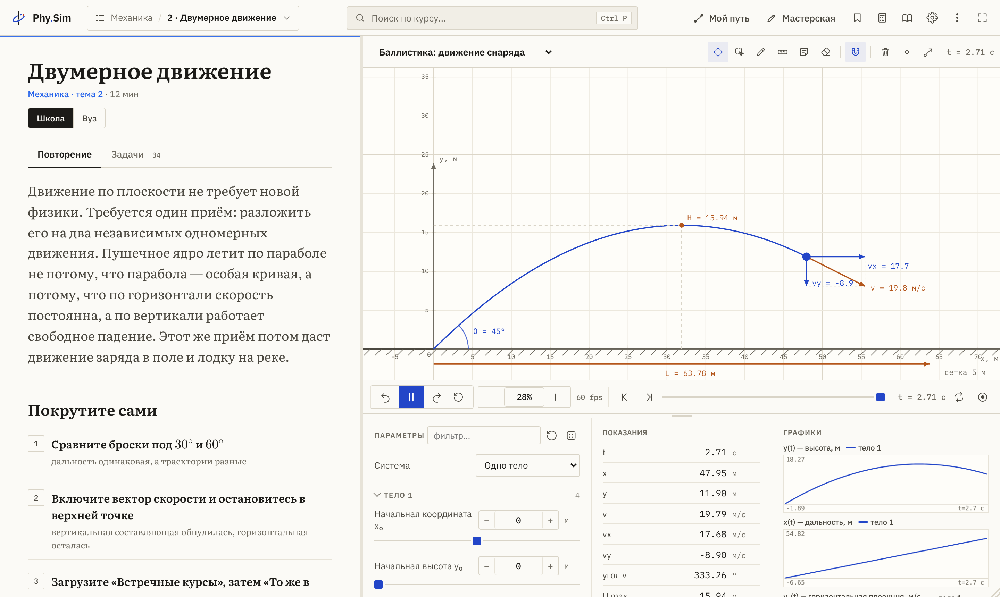
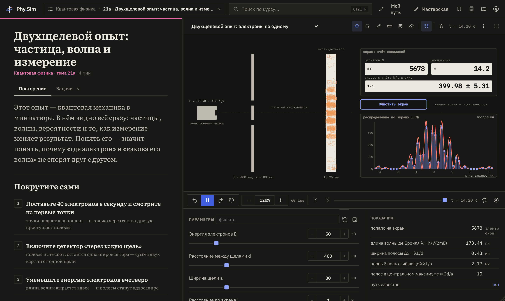
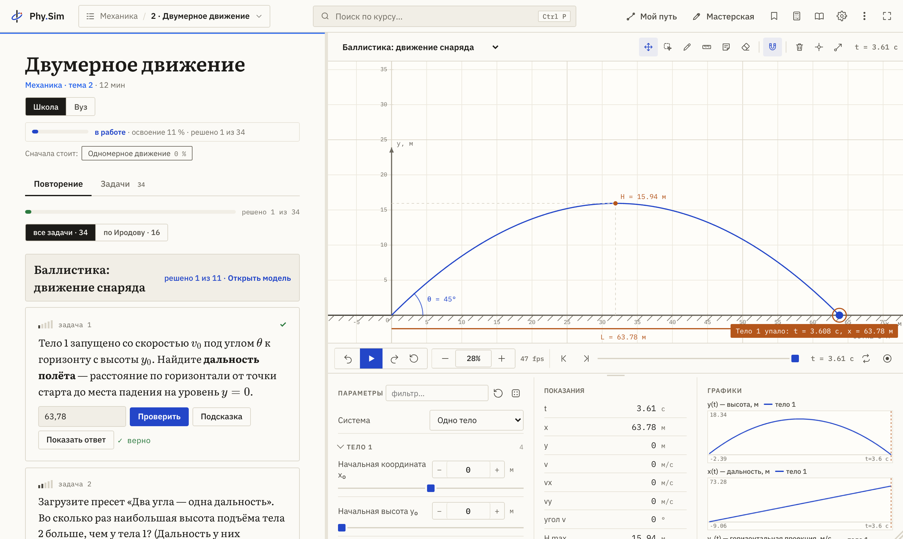
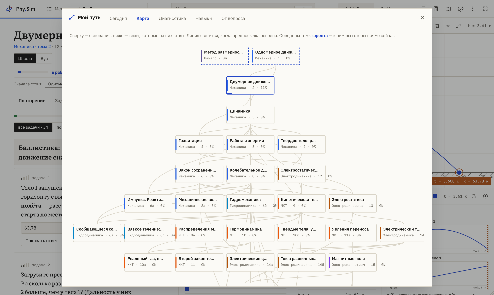
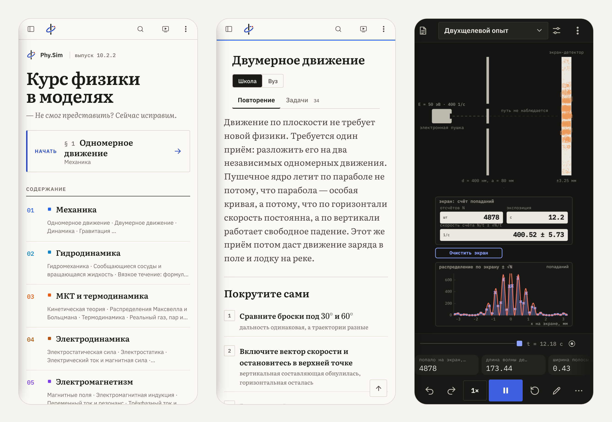

<div align="center">

# Phy.Sim

**Курс физики в моделях. Не смог представить? Сейчас исправим.**

Повторение школьной физики от кинематики до кварков: сначала крутите симуляцию, потом читаете,
почему она повела себя именно так.

[](../../releases/latest)
[](LICENSE)


**[Скачать](../../releases/latest)** · **[Что внутри](#что-внутри)** · **[Установка](#установка)** · **[In English](#in-english)**



</div>

---

## Коротко

- **135 симуляций**, **56 тем**, **693 задачи**: механика, термодинамика, электричество, оптика,
  относительность, квантовая и ядерная физика.
- Каждая тема начинается с опыта: *«поменяйте это — посмотрите на то»*. Теория ниже, она свёрнута.
- Работает **без интернета, без регистрации и без рекламы**. Ничего никуда не отправляет.
- Windows, Linux, Android или просто браузер: везде одно и то же приложение.

> [!NOTE]
> Пособие не учит физике с нуля. Оно для того, чтобы **закрепить** пройденное или разобраться
> в недопонятом.

## Что внутри

<table>
<tr>
<td width="50%" valign="top">

### 🔬 Квантовая лаборатория
Микромир не нарисуешь, его можно только измерить. В квантовых темах вместо «волны со
стрелочкой» стоят стенды: детекторы, счётчики, табло и журнал измерений с погрешностями ±√N.
Закон вы получаете сами, из своих данных.

</td>
<td width="50%" valign="top">

### ✍️ Задачи, которые объясняют ошибку
Неверный ответ сверяется с типичными промахами: синус вместо косинуса, градусы вместо
радиан, забытое трение, потерянный знак. Программа называет, где именно вы ошиблись.

</td>
</tr>
<tr>
<td valign="top">

### 🧭 Мой путь
Карта всех тем и того, на чём каждая держится. Диагностика из 12 задач подскажет, с чего
начать, а повторение напомнит то, что пора освежить.

</td>
<td valign="top">

### 🧮 Инструменты
Калькулятор с единицами и погрешностями (`72 км/ч в м/с`), лаборатория с методом наименьших
квадратов, мастерская для своей симуляции без программирования, печать контрольных.

</td>
</tr>
</table>

<p align="center">
  
  <br><sub>Двухщелевой опыт: электроны прилетают по одному, а полосы проступают из статистики.</sub>
</p>

<table>
<tr>
<td width="50%"></td>
<td width="50%"></td>
</tr>
<tr>
<td align="center"><sub>Задачи с проверкой ответа и прогрессом по теме</sub></td>
<td align="center"><sub>«Мой путь»: карта курса и связи между темами</sub></td>
</tr>
</table>

<p align="center">
  
  <br><sub>На телефоне всё то же самое: конспект, сцена и пульт под одну руку.</sub>
</p>

## Демо

https://github.com/user-attachments/assets/efd65eac-32d3-40f8-8381-c8aeccb81596

## Установка

**[→ Последний выпуск](../../releases/latest)**: выберите файл для своей системы.

| Система | Файл | Как поставить |
|---|---|---|
| **Windows 10/11** | `Phy.Sim-Setup-10.2.2.exe` | Обычный установщик, права администратора не нужны |
| **Windows без установки** | `Phy.Sim-portable-10.2.2.exe` | Запускается прямо с флешки |
| **Fedora** | `Phy.Sim-10.2.2.x86_64.rpm` | Двойной щелчок или `sudo dnf install ./Phy.Sim-*.rpm` |
| **Arch Linux** | `Phy.Sim-10.2.2-x86_64.pkg.tar.xz` | `sudo pacman -U ./Phy.Sim-*.pkg.tar.xz` |
| **Любой Linux** | `Phy.Sim-10.2.2-x86_64.AppImage` | `chmod +x`, затем запустить |
| **Android** | `phy-sim.apk` | Разрешить установку из браузера и открыть файл. **Ноль разрешений** |
| **Что угодно** | [`phy-sim-standalone.html`](phy-sim-standalone.html) | Один файл: открыть в любом браузере |

<details>
<summary><b>Телефон без магазина приложений и iPhone</b></summary>

<br>

Откройте веб-версию на GitHub Pages (`https://<владелец>.github.io/<репозиторий>/`) и нажмите
**«Установить приложение»** в Chrome или **«Поделиться → На экран „Домой“»** в Safari. Появится
иконка, а после первого открытия всё работает без сети.

Чтобы включить веб-версию, владельцу репозитория нужно один раз выбрать
**Settings → Pages → Source: GitHub Actions**.

</details>

<details>
<summary><b>Запуск из исходников и сборка</b></summary>

<br>

Собирать ничего не нужно: `git clone` → открыть `index.html`. KaTeX и шрифты лежат
в репозитории, сетевых запросов нет.

```bash
npm run build                                                # один HTML-файл: phy-sim-standalone.html
npm run build:apk                                            # Android .apk (нужны только JDK, curl, zip)
cd packaging/windows && npm install && npm run dist          # Windows: установщик + portable
cd packaging/windows && npm install && npm run dist:fedora   # Fedora .rpm (нужен rpmbuild)
cd packaging/windows && npm install && npm run dist:arch     # Arch .pkg.tar.xz + AppImage
```

Пакеты для выпуска собирает GitHub Actions (workflow `release.yml`).
Подробности в [packaging/README.md](packaging/README.md).

**Тесты** (нужен `playwright`):

```bash
npm test && npm run physics && npm run audit && npm run curriculum
```

Как устроен код: [docs/ARCHITECTURE.md](docs/ARCHITECTURE.md).
Как добавить тему или симуляцию: [docs/CONTRIBUTING.md](docs/CONTRIBUTING.md).

</details>

## Об авторе

Бобожонов С. Ш., студент ИЯФИТ Ташкентского филиала НИЯУ МИФИ. Проект начинался как пособие
для моих учеников.

Приложение сделано вместе с ИИ-ассистентом Claude: он написал почти все конспекты, архитектуру
и мобильную версию. Поэтому ошибки вполне возможны. Пишите о них в
[Issues](../../issues) или в Телеграм [@TheFirstSomi](https://t.me/TheFirstSomi).

Если пособие помогло, поставьте ⭐. Мне будет очень приятно.

## Лицензия

[GPL-3.0](LICENSE). Пользуйтесь, изучайте, меняйте и делитесь, в том числе на уроках.

---

## In English

**TL;DR:** physics, but you get to break things first. 🧪

Phy.Sim is a pocket physics course (in Russian) with **135 simulations** you can poke at, from a
thrown rock to decaying uranium. The quantum part is a pretend lab with real statistics: switch
on the detectors, wait for the clicks and fit the law yourself. No more wave-with-an-arrow
cartoons.

Get a problem wrong and it tells you *how* you got it wrong (yes, it knows you mixed up sin and
cos). Runs offline on Windows, Linux, Android or any browser. No account, no ads, no tracking,
zero Android permissions.

Built by a first-year physics student together with Claude, so bugs are likely. Please report
them in [Issues](../../issues). [Grab a build →](../../releases/latest)
